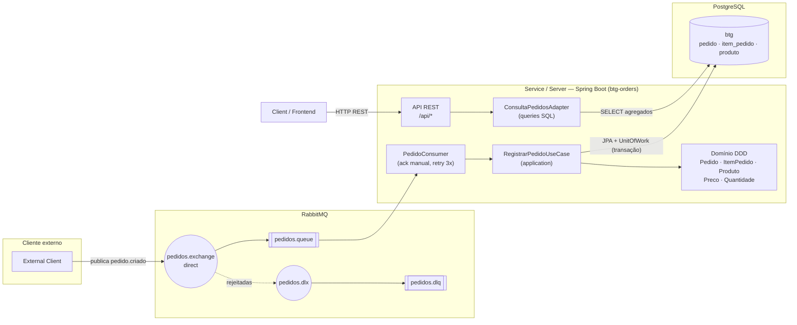
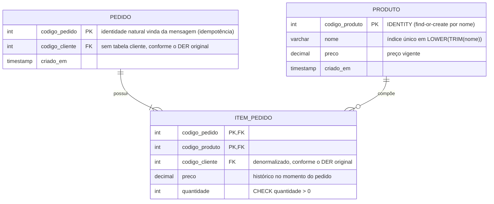
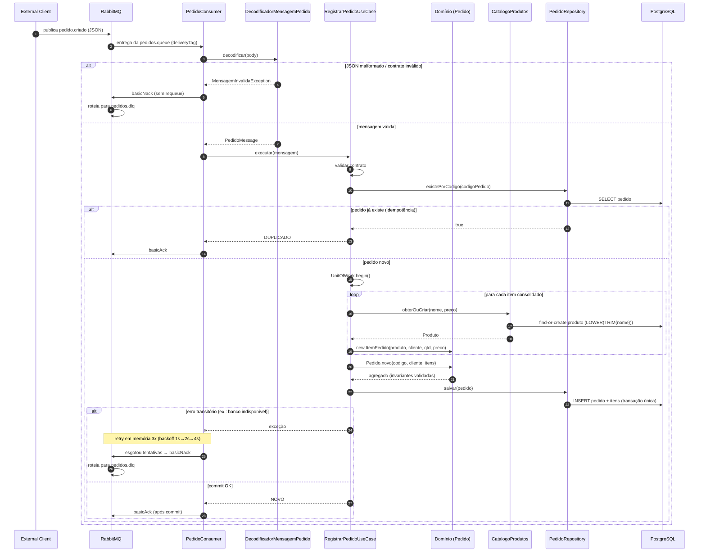
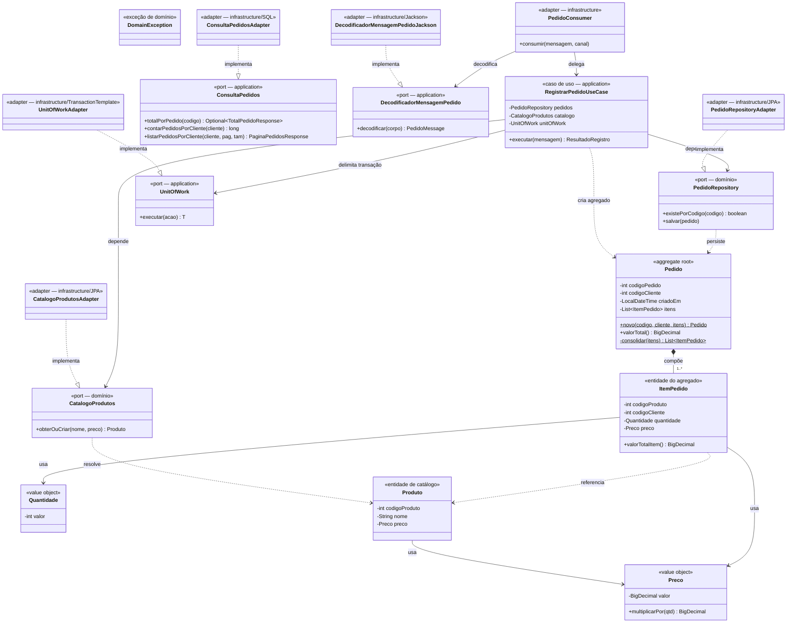
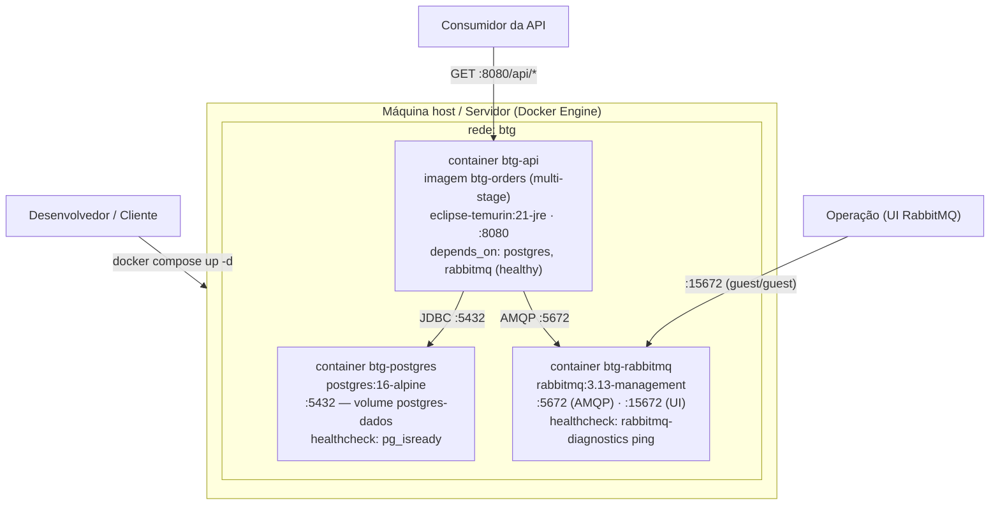

# Desafio-Engenheiro-de-software-BTG-Pactual

Sistema de processamento de pedidos baseado em **microsserviço** com **Java 21 + Spring Boot 3.5**. Consome mensagens de pedidos de uma fila **RabbitMQ**, persiste em **PostgreSQL** e expõe uma **API REST** para consultar valor total do pedido, quantidade de pedidos por cliente e lista de pedidos por cliente.

Arquitetura em **DDD por camadas** (domain, application, infrastructure, api) com **princípios SOLID**, tudo em um único projeto Maven (`com.btg.orders`).

---

## Como funciona

O fluxo segue o diagrama de arquitetura em `doc/diagrama_arquitetura.png` (fonte editável: `doc/diagrama_arquitetura.excalidraw`):

1. Um **cliente externo** publica a mensagem JSON do pedido na exchange `pedidos.exchange` (routing key `pedido.criado`).
2. O **consumer RabbitMQ** (na mesma aplicação da API) consome a fila `pedidos.queue` com ack manual.
3. O caso de uso `RegistrarPedidoUseCase` valida o contrato, resolve produtos por nome (find-or-create), monta o agregado `Pedido` (invariantes do domínio) e persiste tudo em uma única transação no PostgreSQL.
4. Mensagem reenviada (**idempotência**): o pedido não é duplicado — o resultado é `DUPLICADO` e a mensagem é confirmada normalmente.
5. Mensagem **malformada/inválida**: vai para a DLQ (`pedidos.dlq`) sem travar o consumer. Erros transitórios são retentados até 3 vezes (backoff exponencial) antes da DLQ.
6. A **API REST** consulta os dados agregados diretamente no banco (CQRS leve: caminhos de leitura separados dos de escrita).

### Diagrama de arquitetura (Mermaid)



### Modelagem de dados — DER (Mermaid)

Segue o DER em `doc/DER.png` (fonte editável: `doc/DER.drawio`). O valor total **nunca é armazenado** — sempre derivado por `SUM(quantidade * preco)`.



DDL completo em `src/main/resources/db/migration/V1__criar_schema.sql` (aplicado automaticamente pelo Flyway ao iniciar).

### Diagrama de sequência — consumo da mensagem (RabbitMQ → PostgreSQL)

Mostra o fluxo assíncrono completo, incluindo os caminhos de **idempotência** (pedido já existente → ack sem duplicar), **erro permanente** (mensagem inválida → DLQ) e **erro transitório** (retry 3x com backoff → DLQ):



### Diagrama de classes — desenho tático do DDD

Evidencia o agregado `Pedido`, os **value objects**, os **ports** (abstrações) e quem os implementa (adapters da infraestrutura). Setas com rótulo indicam a direção das dependências — domínio e aplicação não conhecem Spring nem JPA:



### Diagrama de implantação (Mermaid)

Um único `docker-compose.yml` sobe os três serviços em rede dedicada (`btg`), com health checks e ordem de dependência (`api` só inicia após `postgres` e `rabbitmq` saudáveis):



---

## Estrutura do projeto (DDD por camadas)

```
src/main/java/com/btg/orders/
├── BtgOrdersApplication.java   # composition root (único ponto que conhece o Spring)
├── domain/                     # regras de negócio puras, sem dependências de framework
│   ├── pedido/                 #   Pedido (aggregate root), ItemPedido, PedidoRepository (port)
│   ├── produto/                #   Produto, CatalogoProdutos (port)
│   └── valor/                  #   Value objects: Preco, Quantidade
├── application/               # casos de uso, DTOs e ports (depende apenas do domínio)
│   ├── caso/                   #   RegistrarPedidoUseCase, Consultar*UseCase, ValidadorMensagemPedido
│   ├── porta/                  #   ConsultaPedidos, UnitOfWork, DecodificadorMensagemPedido
│   └── dto/                    #   PedidoMessage (contrato da fila), respostas da API
├── infrastructure/            # adapters dos ports
│   ├── persistence/            #   JPA entities, repositories, adapters, projections
│   ├── messaging/              #   topologia RabbitMQ (exchange/queue/DLX/DLQ), consumer, decodificador
│   └── transacao/              #   UnitOfWork com TransactionTemplate
└── api/                        # host REST
    ├── web/                    #   controllers, exception handler (ProblemDetails RFC 7807), OpenAPI
    └── config/                 #   registro dos casos de uso (DI)
```

**SOLID na prática**: domínio e aplicação não importam Spring; dependem de abstrações (`PedidoRepository`, `CatalogoProdutos`, `ConsultaPedidos`, `UnitOfWork`) implementadas pela infraestrutura e ligadas na API (DIP). Cada caso de uso tem uma única responsabilidade (SRP); novas consultas/fontes entram por novas implementações de port (OCP/LSP); interfaces pequenas e coesas (ISP).

---

## Como rodar

Pré-requisitos: Docker (com compose) — não precisa de Java/Maven instalados.

```bash
docker compose up -d --build
```

Aguardar a API subir (~15s) e conferir saúde:

```bash
curl http://localhost:8080/health/ready
# {"status":"UP","components":{"db":...,"rabbit":...}}
```

- **API**: http://localhost:8080
- **Swagger**: http://localhost:8080/swagger (redireciona para `/swagger-ui/index.html`)
- **RabbitMQ Management UI**: http://localhost:15672 (guest/guest)

Migrations Flyway são aplicadas automaticamente ao iniciar.

### Publicando a mensagem de exemplo

Via script (usa a Management API do RabbitMQ):

```bash
./scripts/send-message.sh
```

Ou manualmente na UI do RabbitMQ (http://localhost:15672 → Exchanges → `pedidos.exchange` → Publish message), routing key `pedido.criado`:

```json
{
  "codigoPedido": 1001,
  "codigoCliente": 1,
  "itens": [
    { "produto": "lápis",   "quantidade": 100, "preco": 1.10 },
    { "produto": "caderno", "quantidade": 10,  "preco": 1.00 }
  ]
}
```

## Endpoints da API

| Consulta | Endpoint |
|---|---|
| Valor total do pedido | `GET /api/pedidos/{codigoPedido}/total` |
| Quantidade de pedidos por cliente | `GET /api/clientes/{codigoCliente}/pedidos/quantidade` |
| Lista de pedidos por cliente | `GET /api/clientes/{codigoCliente}/pedidos?page=1&size=10` |
| Saúde (readiness: db + rabbit) | `GET /health/ready` |
| Saúde (liveness) | `GET /health/live` |

Exemplos:

```bash
curl http://localhost:8080/api/pedidos/1001/total
# {"codigoPedido":1001,"codigoCliente":1,"valorTotal":120.00}

curl http://localhost:8080/api/clientes/1/pedidos/quantidade
# {"codigoCliente":1,"quantidadePedidos":1}

curl "http://localhost:8080/api/clientes/1/pedidos?page=1&size=10"
# {"codigoCliente":1,"pagina":1,"tamanho":10,"totalPedidos":1,
#  "pedidos":[{"codigoPedido":1001,"criadoEm":"...","valorTotal":120.00,"quantidadeItens":2}]}

curl -i http://localhost:8080/api/pedidos/999999/total   # 404 (ProblemDetails)
curl -i http://localhost:8080/api/pedidos/abc/total       # 400 (ProblemDetails)
```

Erros seguem **ProblemDetails (RFC 7807)**: 404 pedido inexistente, 400 parâmetros inválidos, 500 erro interno (com log estruturado).

## Testes

- **Unidade** (domínio + aplicação, com fakes em memória): 32 testes — invariantes (preço/quantidade/códigos), consolidação de itens duplicados, cálculo do total, idempotência, validação do contrato da mensagem.
- **Integração** (`FluxoPedidosIT`, 8 testes): Postgres 16 e RabbitMQ 3.13 **reais** via Testcontainers — publica na fila e valida o fluxo completo (total 120.00, duplicidade, DLQ, 404, 400, health).
- **Cobertura**: JaCoCo com mínimo de 80% na camada `domain` (build falha abaixo disso).

```bash
./mvnw clean verify          # tudo (unit + integração + cobertura)
./mvnw test                  # apenas unitários
```

## Comportamento da mensageria

| Cenário | Comportamento |
|---|---|
| Mensagem válida nova | Persiste em transação única → `basicAck` após commit |
| Mensagem reenviada (mesmo `codigoPedido`) | `DUPLICADO` → ack normal, sem duplicar |
| JSON malformado / viola invariantes | `MensagemInvalidaException` → nack sem requeue → `pedidos.dlq` |
| Erro transitório (ex.: banco indisponível) | Retry em memória até 3x (backoff 1s→2s→4s) → DLQ |
| Corrida de insert duplicado | `DataIntegrityViolationException` → ack (idempotência garantida) |

Topologia declarada pela aplicação ao iniciar (idempotente): exchange direct `pedidos.exchange` → fila `pedidos.queue` (durable, DLX `pedidos.dlx`) → `pedidos.dlq`. Prefetch = 10, ack manual.

## Referências dos diagramas

- Diagrama de arquitetura: `doc/diagrama_arquitetura.png` / `doc/diagrama_arquitetura.excalidraw`
- DER: `doc/DER.png` / `doc/DER.drawio`
